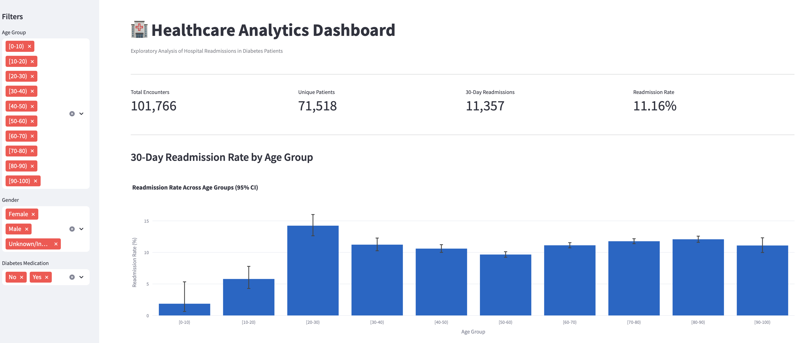
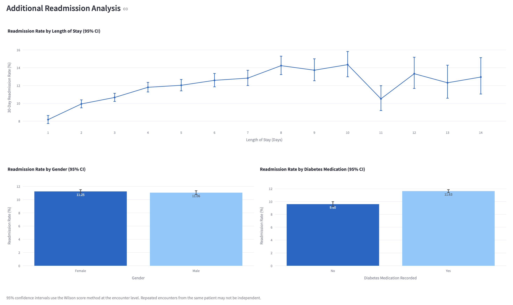

# 🏥 Healthcare Analytics Dashboard

An interactive healthcare analytics dashboard for exploring 30-day hospital readmissions among patients with diabetes using Python, Pandas, Plotly, and Streamlit.

## Project Overview

Hospital readmissions are an important indicator in healthcare quality assessment and resource planning. Understanding how readmission rates vary across patient characteristics and clinical encounters can help identify patterns that warrant further investigation.

This project analyzes hospital encounter data from patients with diabetes, focusing on 30-day readmission rates across age groups, gender, length of hospital stay, and diabetes medication status.

The project combines exploratory data analysis, statistical confidence intervals, and interactive data visualization in a Streamlit dashboard.

## Dashboard Preview

### Overview



### Readmission Analysis



## Dataset

**Dataset:** Diabetes 130-US Hospitals for Years 1999–2008

**Source:** UCI Machine Learning Repository

https://archive.ics.uci.edu/dataset/296/diabetes+130-us+hospitals+for+years+1999-2008

The dataset contains clinical encounter records from 130 US hospitals and integrated delivery networks between 1999 and 2008.

### Dataset Summary

| Metric | Value |
|---|---:|
| Total Hospital Encounters | 101,766 |
| Unique Patients | 71,518 |
| 30-Day Readmissions | 11,357 |
| Overall 30-Day Readmission Rate | 11.16% |
| Number of Variables in Processed Dataset | 50 |

The primary outcome is a binary variable, `readmitted_30d`, indicating whether a hospital encounter was followed by readmission within 30 days.

## Project Objectives

- Explore patterns in 30-day hospital readmissions among patients with diabetes.
- Compare readmission rates across demographic and clinical subgroups.
- Quantify uncertainty using 95% confidence intervals.
- Develop an interactive dashboard for exploring healthcare encounter data.
- Demonstrate an end-to-end workflow involving data preparation, statistical analysis, and visualization.

## Methodology

### 1. Data Preparation

Data preparation and exploratory analysis were performed using Python and Pandas.

The workflow includes:

- Loading and inspecting the original dataset.
- Preparing a binary 30-day readmission outcome.
- Reviewing demographic and clinical variables.
- Validating required columns and outcome values.
- Exporting a cleaned dataset for dashboard analysis.

### 2. Exploratory Data Analysis

Readmission rates were calculated using:

**Readmission Rate (%) = (30-Day Readmissions / Total Encounters) × 100**

Subgroup analyses were performed for:

- Age Group
- Length of Hospital Stay
- Gender
- Diabetes Medication Status

### 3. Statistical Analysis

Wilson score confidence intervals were calculated to estimate 95% confidence intervals for readmission proportions.

These intervals provide information about the uncertainty associated with estimated readmission rates, particularly for subgroups with smaller sample sizes.

### 4. Interactive Visualization

An interactive dashboard was developed using Streamlit and Plotly.

Users can filter records by age group, gender, and diabetes medication status. Dashboard metrics and visualizations update dynamically based on the selected population.

## Dashboard Features

### Key Performance Indicators

The dashboard displays four dynamically updated metrics:

- Total Hospital Encounters
- Unique Patients
- 30-Day Readmissions
- 30-Day Readmission Rate

### Interactive Filters

- Age Group
- Gender
- Diabetes Medication Status

### Visualizations

1. **Readmission Rate by Age Group:** Bar chart with 95% confidence intervals.
2. **Readmission Rate by Length of Stay:** Line chart with 95% confidence intervals.
3. **Readmission Rate by Gender:** Comparison of female and male encounter-level readmission rates.
4. **Readmission Rate by Diabetes Medication Status:** Comparison of encounters with and without recorded diabetes medication.

The dashboard also provides a summary table for age-group analysis.

## Key Findings

The exploratory analysis identified several patterns:

- The overall 30-day readmission rate was **11.16%**.
- Readmission rates varied across age groups, with the 20–30 age group showing a relatively high observed rate of **14.24%**.
- Readmission rates generally increased with longer hospital stays over the earlier lengths of stay, although the pattern was not strictly monotonic.
- Female and male encounters had similar observed readmission rates, at **11.25%** and **11.06%**, respectively.
- Encounters with recorded diabetes medication had an observed readmission rate of **11.63%**, compared with **9.60%** for encounters without recorded diabetes medication.

These findings are descriptive associations and should not be interpreted as evidence of causation.

## Technologies Used

| Category | Technologies |
|---|---|
| Programming Language | Python |
| Data Processing | Pandas, NumPy |
| Statistical Analysis | Wilson Score Confidence Intervals |
| Data Visualization | Plotly, Matplotlib, Seaborn |
| Dashboard | Streamlit |
| Development Environment | VS Code, Jupyter Notebook |
| Version Control | Git, GitHub |

## Project Structure

```text
healthcare-analytics-dashboard/
├── app.py
├── data/
│   ├── raw/
│   └── processed/
│       └── diabetes_cleaned.csv
├── figures/
├── notebooks/
│   └── 01_data_exploration.ipynb
├── sql/
├── src/
├── tests/
├── requirements.txt
├── .gitignore
├── LICENSE
└── README.md
```

## How to Run

### 1. Clone the Repository

```bash
git clone https://github.com/chendola00/healthcare-analytics-dashboard.git
cd healthcare-analytics-dashboard
```

### 2. Create a Virtual Environment

```bash
python3 -m venv .venv
source .venv/bin/activate
```

### 3. Install Dependencies

```bash
pip install -r requirements.txt
```

### 4. Prepare the Dataset

Download the original dataset from the UCI Machine Learning Repository.

Run the data preparation workflow in:

`notebooks/01_data_exploration.ipynb`

Ensure the processed dataset is saved to:

`data/processed/diabetes_cleaned.csv`

### 5. Launch the Dashboard

```bash
streamlit run app.py
```

Open the local URL displayed in the terminal.

## Limitations

- The analysis is observational and does not establish causal relationships.
- The dataset represents historical hospital encounters from 1999–2008 and may not reflect current clinical practice.
- Multiple encounters may belong to the same patient. The reported Wilson confidence intervals treat encounters as independent observations and do not adjust for within-patient correlation.
- Differences between subgroups may be influenced by confounding factors.
- The dashboard provides exploratory analytics rather than individualized clinical risk predictions.

## Future Improvements

Potential extensions include:

- SQL-based healthcare data analysis.
- Statistical hypothesis testing and multivariable analysis.
- Predictive modeling for 30-day readmission risk.
- Patient-level validation and subgroup performance evaluation.
- Additional dashboard filters and visualizations.

## Data Attribution

Diabetes 130-US Hospitals for Years 1999–2008, UCI Machine Learning Repository.

The original dataset is associated with:

Strack, B., et al. (2014). *Impact of HbA1c Measurement on Hospital Readmission Rates: Analysis of 70,000 Clinical Database Patient Records.* BioMed Research International.

## Author

Developed as a personal healthcare data analytics portfolio project.

**GitHub:** https://github.com/chendola00
